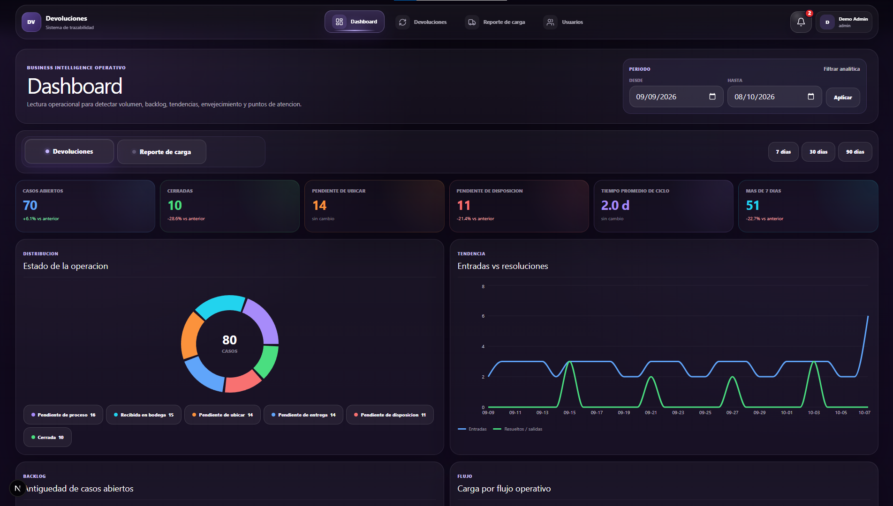
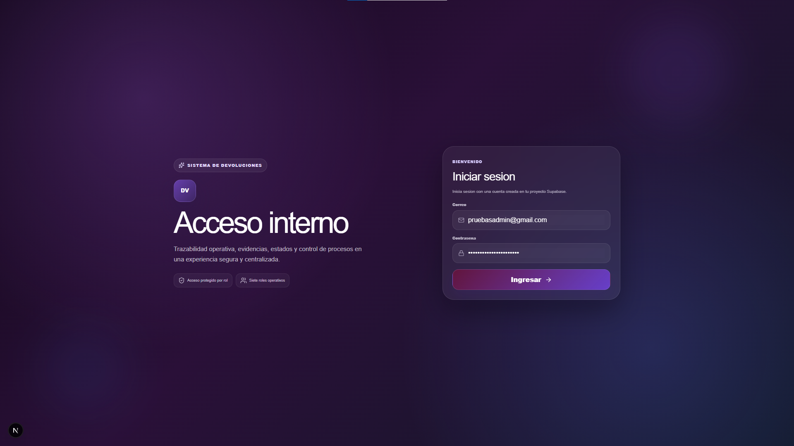
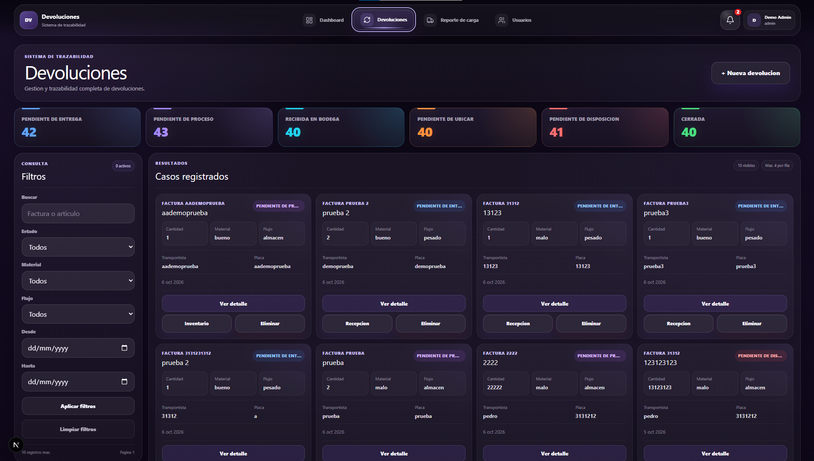
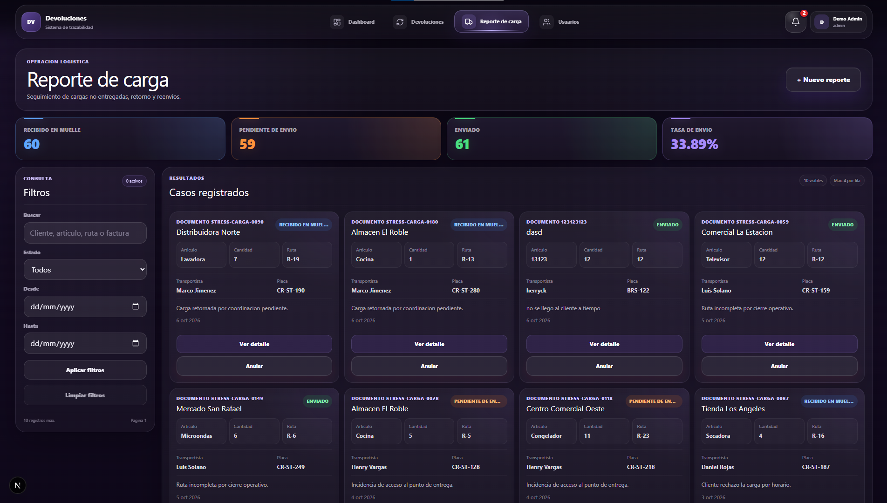
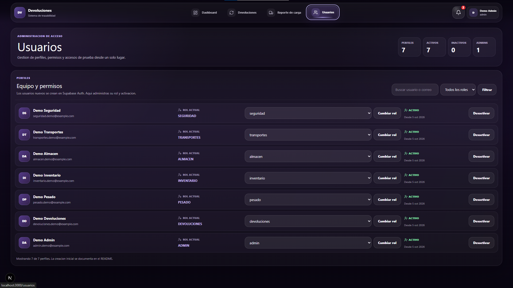

# DDevoluciones

Aplicacion web para gestionar devoluciones, evidencias, reportes de carga y flujos operativos con autorizacion basada en roles.

El proyecto utiliza Next.js y Supabase para implementar una aplicacion operativa con trazabilidad, almacenamiento privado de evidencias, Row Level Security (RLS), RPC protegidas y verificaciones automatizadas de permisos.

<!-- DDEVOLUCIONES_SCREENSHOTS_START -->

## Vista previa

### Dashboard



### Pantallas principales

| Inicio de sesion                                 | Devoluciones                                            |
| ------------------------------------------------ | ------------------------------------------------------- |
|  |  |

| Reporte de carga                                    | Usuarios                                                |
| --------------------------------------------------- | ------------------------------------------------------- |
|  |  |

<!-- DDEVOLUCIONES_SCREENSHOTS_END -->

## Funcionalidades

- Registro y seguimiento de devoluciones.
- Flujos independientes para Pesado y Almacen.
- Clasificacion de material bueno, malo o mixto.
- Recepcion fisica y validacion de cantidades.
- Control de inventario y pallet.
- Ubicacion de material aprovechable.
- Disposicion de material no aprovechable.
- Evidencias fotograficas privadas.
- Historial de eventos y auditoria.
- Reportes de carga y redespacho.
- Notificaciones operacionales por rol y usuario.
- Dashboard y analitica operativa.
- Administracion de usuarios, roles y estado de acceso.

## Roles

El sistema utiliza siete roles:

| Rol            | Responsabilidad principal                       |
| -------------- | ----------------------------------------------- |
| `admin`        | Administracion y operacion completa             |
| `devoluciones` | Registro y gestion inicial de devoluciones      |
| `pesado`       | Recepcion fisica y ubicacion del flujo Pesado   |
| `inventario`   | Inventario, clasificacion, disposicion y cargas |
| `almacen`      | Ubicacion del material bueno del flujo Almacen  |
| `transportes`  | Operacion autorizada de reportes de carga       |
| `seguridad`    | Operacion autorizada de reportes de carga       |

La interfaz no es la autoridad de seguridad. Los permisos efectivos se validan en servidor, RPC y politicas RLS.

## Stack

- Next.js 16
- React
- TypeScript
- Tailwind CSS
- Supabase Auth
- PostgreSQL / Supabase
- Supabase Storage
- Zod
- Vitest
- Testing Library
- ESLint

## Arquitectura

El proyecto separa responsabilidades entre interfaz, features, dominio, repositorios, servicios e infraestructura.

```text
app / components
       |
       v
    features
       |
       v
domain / schemas
       |
       v
repositories / services
       |
       v
Supabase / PostgreSQL / Storage
```

Documentacion detallada:

- [Arquitectura](docs/ARCHITECTURE.md)
- [Seguridad](docs/SECURITY.md)
- [Testing y verificacion](docs/TESTING.md)

## Rutas principales

```text
/login
/dashboard
/devoluciones
/reportes-carga
/usuarios
```

Las rutas disponibles dependen del rol y del estado activo del perfil.

## Configuracion local

### Requisitos

- Node.js compatible con `.nvmrc`
- npm
- Un proyecto Supabase separado para desarrollo/demo

Instala dependencias:

```bash
npm install
```

Crea el archivo `.env.local` a partir de `.env.example`.

Variables publicas requeridas:

```dotenv
NEXT_PUBLIC_SUPABASE_URL=
NEXT_PUBLIC_SUPABASE_PUBLISHABLE_KEY=
```

Nunca publiques claves `service_role`, `sb_secret_*` ni otras credenciales privilegiadas.

## Base de datos

Las migraciones se encuentran en `supabase/migrations/`.

Para preparar una base nueva, ejecutalas en orden alfanumerico desde Supabase SQL Editor.

El repositorio no requiere Docker para este flujo.

## Usuarios demo

El proyecto incluye soporte para siete identidades de demostracion.

El seed requiere variables privadas definidas solamente durante su ejecucion:

```text
SUPABASE_SECRET_KEY
```

o, para proyectos que aun utilicen la clave legacy:

```text
SUPABASE_SERVICE_ROLE_KEY
```

Tambien requiere:

```text
DEMO_USERS_PASSWORD
```

Estas variables nunca deben guardarse en el repositorio.

Ejecuta:

```bash
npm run seed:demo-users
npm run verify:demo-login
```

Las cuentas publicas normales no pueden asignarse un rol privilegiado ni activarse a si mismas.

## Calidad

Validacion local:

```bash
npm run typecheck
npm run lint
npm test
npm run build
npm audit --omit=dev --audit-level=high
```

Verificaciones remotas:

```bash
npm run verify:demo-login
npm run verify:devoluciones
npm run verify:reportes-carga
npm run verify:security
```

La matriz de seguridad valida, entre otros controles:

- escalamiento de privilegios;
- IDOR entre perfiles y flujos;
- escritura directa no autorizada;
- autorizacion de RPC;
- aislamiento de Storage;
- proteccion de evidencias ya registradas.

## Seguridad

El modelo aplica defensa en profundidad:

- RLS habilitado en tablas de aplicacion;
- sin CRUD directo para `anon`;
- mutaciones sensibles mediante RPC;
- validacion de usuario activo y rol;
- funciones internas no expuestas;
- bucket de evidencias privado;
- limite de 5 MB;
- JPEG, PNG y WebP;
- separacion de evidencias por modulo;
- proteccion contra eliminacion de evidencia ya referenciada;
- secretos fuera del codigo y de Git.

Consulta [docs/SECURITY.md](docs/SECURITY.md) para el detalle.

## Estructura

```text
src/
├── app/
├── components/
├── constants/
├── domain/
├── features/
├── lib/
├── repositories/
├── schemas/
├── services/
├── test/
└── types/

scripts/
supabase/
docs/
```

## Estado de verificacion

La ultima auditoria integral confirmo:

- TypeScript sin errores.
- ESLint sin errores.
- 12 archivos de prueba aprobados.
- 43 pruebas aprobadas.
- 0 vulnerabilidades de produccion detectadas por `npm audit`.
- build de produccion correcto.
- autenticacion validada con los siete roles.
- matriz IDOR y escalamiento aprobada.
- aislamiento y proteccion de Storage aprobados.

## Alcance

DDevoluciones es una reconstruccion tecnica orientada a demostracion y portafolio. Los datos, usuarios y credenciales utilizados para pruebas deben pertenecer exclusivamente al entorno demo.
