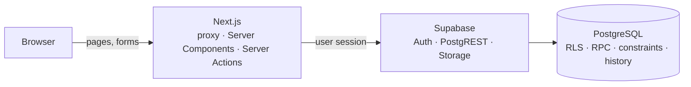

# Devoluciones

Returns traceability for a distribution center. A return is registered with its invoice, item, carrier and photo evidence, then follows its route through the warehouse — physical reception, inventory, and location of good material or disposal of damaged material — until every part of it is closed. A second module tracks loads that could not be delivered, from their return to the dock until they are dispatched again.

Built with Next.js, TypeScript and Supabase. Seven roles see only their part of the process, and PostgreSQL enforces every permission and state transition.

## Screenshots


| Returns                                                                                  | Load reports                                                         |
| ---------------------------------------------------------------------------------------- | -------------------------------------------------------------------- |
|  |  |

| Users                                                    | Sign in                                  |
| -------------------------------------------------------- | ---------------------------------------- |
|  |  |

- **Dashboard:** KPIs against the previous period, distribution by state, flow, material, item, carrier and plate, entries versus resolved cases, aging and attention points, with cross-filtering.
- **Returns:** state summary, filters, one card per case with the actions its role can take at that stage, and the full history of each case.
- **Load reports:** returned loads, their redispatch and the dispatch rate.
- **Users:** role and access status of every account (administrators only).

## Features

- **Two operational flows.** _Pesado_ returns wait for physical delivery and reception with a signed invoice; _Almacén_ returns go straight to inventory.
- **Good, damaged or mixed material.** Inventory splits a return into material lines: good material is located in the warehouse, damaged material gets a final disposal. The return closes only when all its lines are closed.
- **Private photo evidence** at every stage (JPEG, PNG or WebP up to 5 MB), stored per user and per module; evidence attached to a case cannot be deleted by its uploader.
- **Full traceability:** every transition is recorded with its author; deleted returns keep a complete snapshot.
- **Load reports:** returned loads with reason and physical state, redispatch with driver, plate and evidence, and administrative voiding that keeps the history.
- **Notifications** per role and per user, with read state.
- **Executive dashboard** with period comparison and drill-down to the filtered list.
- **Seven roles** — `admin`, `devoluciones`, `pesado`, `inventario`, `almacen`, `transportes`, `seguridad` — with accounts managed from the terminal and no public sign-up.

The full list, with business rules, is in [docs/requirements.md](docs/requirements.md).

## Tech stack

| Layer         | Technology                                                                             |
| ------------- | -------------------------------------------------------------------------------------- |
| Framework     | Next.js 16.4 (App Router, Server Actions), React 19.2                                  |
| Language      | TypeScript 5.9 (strict)                                                                |
| UI            | Tailwind CSS 4 with the application's own stylesheet, Lucide, Recharts                 |
| Validation    | Zod 4                                                                                  |
| Data and auth | Supabase (Auth, PostgREST, Storage) on PostgreSQL 17                                   |
| Testing       | Vitest (unit and integration), Playwright with axe-core (end to end and accessibility) |
| Tooling       | Supabase CLI, ESLint, Prettier, GitHub Actions, Dependabot                             |

## Architecture



- The browser only talks to the Next.js server. Pages read through repositories and forms post to Server Actions that validate with Zod, check the session, active profile and role, and call an RPC with the user's session.
- Every table has row-level security; sessions can read only what their role and flow allow and cannot write directly. Each transition is a `SECURITY DEFINER` function that checks role, flow and current state under a row lock.
- Evidence lives in a private bucket whose policies restrict uploads and deletions to the user's own folder and module.
- Each response carries a nonce-based Content Security Policy; the session cookie is `httpOnly` and bounded to 12 hours.

Details are in [docs/architecture.md](docs/architecture.md) and [docs/database.md](docs/database.md).

## Project structure

```text
src/
├─ app/              routes, layouts, styles (ordered layers in app/styles)
├─ components/       application shell, returns, load reports, dashboard, UI primitives
├─ features/         Server Actions per module (auth, returns, load reports, users, notifications)
├─ domain/           pure rules (dashboard periods, metrics and snapshots, state derivation)
├─ repositories/     Supabase reads and RPC calls
├─ schemas/          Zod input validation
├─ services/         private evidence storage
├─ lib/              auth guards, Supabase clients, CSP, security events, list helpers
├─ constants/        roles and route access map
└─ proxy.ts          session refresh and CSP nonce
supabase/
├─ migrations/       forward-only schema history
└─ config.toml       local stack (ports 55420–55429)
scripts/             env:local, users, demo:setup
tests/integration/   tests against the database
e2e/                 Playwright end-to-end and accessibility tests
docs/                requirements, architecture, database, decisions, security, testing
```

## Prerequisites

- Node.js 22.18 or later (`.nvmrc` pins 22.23.3)
- npm 10
- Docker (for the local Supabase stack)

## Getting started

```bash
git clone https://github.com/Aaron23486/ddevoluciones.git
cd ddevoluciones
npm ci
npm run db:up        # local Supabase: applies all migrations to an empty database
npm run env:local    # writes .env.local with the local URL and publishable key
npm run demo:setup   # demo accounts (passwords shown once) and fictional data
npm run dev          # http://localhost:3000
```

The first `db:up` downloads the Supabase images and can take several minutes.

## Environment configuration

The web app needs only public values, written by `npm run env:local`:

| Variable                               | Purpose                                             |
| -------------------------------------- | --------------------------------------------------- |
| `NEXT_PUBLIC_SUPABASE_URL`             | Supabase API URL (`http://127.0.0.1:55421` locally) |
| `NEXT_PUBLIC_SUPABASE_PUBLISHABLE_KEY` | Publishable key of that project                     |

`.env.example` documents them. The secret key is never stored in the project: terminal scripts read it from `supabase status` or, for a hosted project, from `SUPABASE_URL`, `SUPABASE_PUBLISHABLE_KEY` and `SUPABASE_SECRET_KEY` in the shell.

## Database setup

Each evaluator runs their own database. `npm run db:up` starts PostgreSQL, Auth, PostgREST and Storage in Docker on ports 55420–55429 and applies `supabase/migrations` in order, including the private evidence bucket.

| Command                     | Purpose                                                        |
| --------------------------- | -------------------------------------------------------------- |
| `npm run db:up` / `db:down` | Start or stop the local stack                                  |
| `npm run db:status`         | URLs and keys of the local stack                               |
| `npm run db:reset`          | Recreate the database from the migrations (deletes local data) |

Studio is available at http://127.0.0.1:55423. To use a hosted project instead, see [docs/deployment.md](docs/deployment.md).

## Authentication and demo access

There is no public sign-up: accounts are created from the terminal, and new Auth identities start inactive with the least privileged role.

```bash
npm run demo:setup
```

It creates or refreshes one account per role and prints their generated passwords once:

| Role           | Email                           | Can                                                            |
| -------------- | ------------------------------- | -------------------------------------------------------------- |
| `admin`        | `admin.demo@example.com`        | Every module and stage, user administration, deletion, voiding |
| `devoluciones` | `devoluciones.demo@example.com` | Register returns, dashboard                                    |
| `pesado`       | `pesado.demo@example.com`       | Receive and locate returns of the Pesado flow                  |
| `inventario`   | `inventario.demo@example.com`   | Inventory and disposal; register and redispatch load reports   |
| `almacen`      | `almacen.demo@example.com`      | Locate good material of the Almacén flow                       |
| `transportes`  | `transportes.demo@example.com`  | Register load reports                                          |
| `seguridad`    | `seguridad.demo@example.com`    | Register load reports                                          |

On an empty database it also registers 28 returns across every stage and 12 load reports (references starting with `DEMO-`), each step performed by the account of the responsible role with placeholder evidence images. Run it again to get new passwords. It refuses to run against a hosted project.

Account management:

```bash
npm run create-admin                              # first administrator (prompts for email and password)
npm run users -- list
npm run users -- create --role pesado --name "Nombre Apellido"
npm run users -- deactivate <email>               # activate, set-role --role <role>, reset-password
```

Passwords are prompted, never passed as arguments, and need at least 12 characters with letters and digits. They can only be changed from the terminal. The database refuses to deactivate or demote the last active administrator, and records every role or status change.

## Running locally

```bash
npm run dev                      # development server on :3000
npm run build && npm run start   # production build
```

Sign in at http://localhost:3000/login. To follow a return end to end: register it as `devoluciones`, receive it as `pesado`, process it as `inventario`, then locate or dispose of its material as `pesado`/`almacen` and `inventario`. Each role sees the action buttons that apply to its stage.

## Testing and quality checks

| Command                                                     | What it runs                                                                   |
| ----------------------------------------------------------- | ------------------------------------------------------------------------------ |
| `npm run format:check`, `npm run lint`, `npm run typecheck` | Prettier, ESLint, TypeScript                                                   |
| `npm run test:coverage`                                     | Unit tests; fails below 85% coverage of the logic modules                      |
| `npm run test:integration`                                  | Flows, permissions, storage rules and concurrency against the local database   |
| `npm run test:e2e`                                          | Playwright on a production build (port 3100), including axe WCAG 2.1 AA checks |

Integration and end-to-end tests need `npm run db:up`; the first end-to-end run needs `npx playwright install chromium`. They create and remove their own accounts, data and files. CI runs all of them on every pull request. See [docs/testing.md](docs/testing.md).

## Security

- Authorization in PostgreSQL: row-level security on every table, writes only through role- and state-checked RPCs, internal helpers closed to clients.
- Private evidence: per-user and per-module storage policies, files referenced by a case cannot be deleted, and evidence rows must point to the caller's own uploaded file; uploads are checked by content type and signature.
- Input limits in Zod and again as database constraints.
- `httpOnly` session cookie and bounded sessions (12 hours, 4 hours idle); passwords change only from the terminal, which also closes open sessions.
- Per-request nonce CSP without inline scripts, HSTS and hardening headers; security events without personal data.
- Dependency audit and secret scanning in CI.

Controls, how they are tested and the remaining risks are in [docs/security.md](docs/security.md). Please report vulnerabilities as described in [SECURITY.md](SECURITY.md).

## Engineering decisions

- **The database is the security boundary.** I kept roles, flows and state transitions in SQL so no client can skip them, and tested them against a real database instead of mocks ([ADR 0001](docs/decisions/0001-database-as-authorization-boundary.md)).
- **Server-only data access.** The browser never talks to Supabase, which lets the session cookie be `httpOnly` and the CSP allow only the app's own origin ([ADR 0002](docs/decisions/0002-server-only-data-access.md), [ADR 0004](docs/decisions/0004-per-request-nonce-csp.md)).
- **Local stack and terminal accounts.** Anyone can run the project with Docker and one command per step, without access to my Supabase project; there is no sign-up or access-request queue to maintain ([ADR 0003](docs/decisions/0003-local-supabase-and-terminal-accounts.md)).
- **Evidence is part of the record.** Files are private, owned and immutable once referenced ([ADR 0005](docs/decisions/0005-private-evidence-storage.md)).

## Known limitations

- The stylesheet keeps the layered overrides it grew with; it is split into ordered files, but removing dead rules would need visual regression tests.
- Login throttling relies on Supabase Auth's per-IP limits.
- Password recovery is a terminal task; there is no "forgot password" screen.
- Evidence images are stored but not previewed in the case history.
- Dates use the America/Costa_Rica time zone.
- The UI is in Spanish.

## License

[MIT](LICENSE) © 2026 Aaron23486
